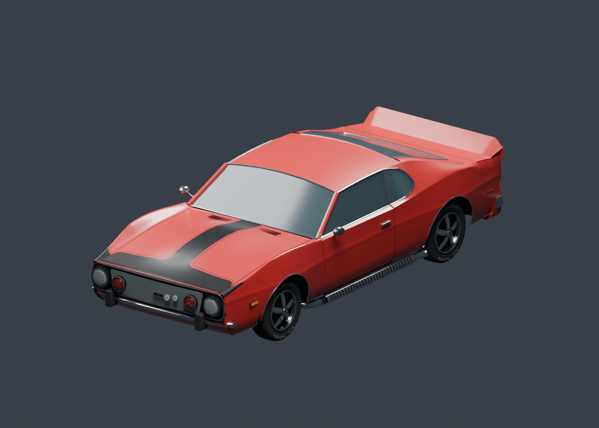

# 1973 AMC Javelin AMX Pierre Cardin

A Dead Signal Interactive creation.

Current development: [project status and takeover](docs/project-status.md) · [latest assembled STL car](assets/current-stl/Javelin73PC-current.blend) · [camera mod](camera/AGENTS.md) · [Fast Load, untested](fast-load/verification.md).

An original car mod based on [Bob La Cross's 1973 AMX video](https://www.youtube.com/watch?v=ZpfnHMBiRvA).

[Install](#install) · [Vehicle](#vehicle) · [Verification](#verification) · [Build](#build) · [Sources](#sources) · [Changes](CHANGELOG.md)

## Install

Place the complete [Javelin73PC](Javelin73PC/) folder inside your Zomboid `mods` folder, then enable **1973 AMC Javelin AMX Pierre Cardin** in Mods and restart the game.

The vehicle script is **`Base.Javelin73PC`**. `Base.` is the game namespace; the separately installed `Base.en_amc_javelin_72` belongs to another mod.

The [installer](tools/install_mod.py) validates the package, preserves backups of owned updates and refuses to replace unrelated or unmarked mod folders. [Installation details](docs/verification.md#installation).

## Vehicle

Red two-door coupe with four seats, black T hood graphic, chrome bumpers, side exhausts, four individually framed rear lamps and original Pierre Cardin-inspired upholstery. Uses native sports-car mechanics, repairable parts, loot and rare world-spawn registration.

This is a low-poly adaptation for the game's viewing scale. Rims, badges and some body transitions are simplified. The banner depicts the editable source model.

## Verification

Read the [verification report](docs/verification.md) for current checks and remaining runtime limits. Native import and Blender checks do not replace in-game inspection.

<table>
<tr><th>Project file</th><th>Purpose</th></tr>
<tr><td><a href="SPEC.md">Specification</a></td><td>Target, scope and acceptance criteria</td></tr>
<tr><td><a href="docs/reference-study.md">Reference study</a></td><td>Observed features and asset provenance</td></tr>
<tr><td><a href="docs/research-1973.md">1973 research</a></td><td>Four research passes grounded in factory literature and the video car</td></tr>
<tr><td><a href="docs/geometry-review.md">Geometry review</a></td><td>Nine review passes, including remaining native inspection</td></tr>
<tr><td><a href="docs/import-contract.md">Import contract</a></td><td>Native coordinate, rig and shader evidence</td></tr>
<tr><td><a href="assets/Javelin73PC.blend">Blender source</a></td><td>Original editable model</td></tr>
<tr><td><a href="AGENTS.md">Project guidance</a></td><td>Operational authority and DOX hierarchy</td></tr>
</table>

## Build

Requires Blender, Python and the installed target game for native compatibility checks. Run from the project root:

<table><tr><td align="left"><pre>blender --background --python tools/build_mod.py
python tools/validate_mod.py --game "&lt;game-directory&gt;"
python tools/check_game_syntax.py --game "&lt;game-directory&gt;"
python tools/check_fbx_import.py --game "&lt;game-directory&gt;"
python tools/check_model_pose.py
python -m unittest discover -s tools -p "test_*.py"
python tools/install_mod.py --game "&lt;game-directory&gt;"</pre></td></tr></table>

[Tool contracts](tools/AGENTS.md) document the export workflow and isolated runtime test. Development test hooks are excluded from the installed package.

## Sources

The current prototype uses the user-owned full-car STL with original project equipment, textures, rigging and gameplay integration, plus the accepted Meshy cockpit assets. The earlier procedural source is preserved separately. External video and photographs are viewing references. The unrelated old Javelin mod is technical reference only; none of its assets are included.

DOX project guidance is installed from [raiinman/dox](https://github.com/raiinman/dox), with its [MIT license](docs/licenses/DOX-MIT.txt).

