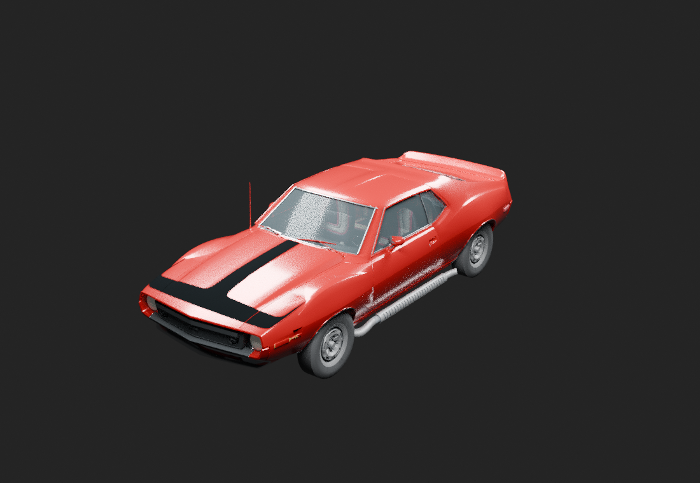

# 1973 AMC Javelin AMX Pierre Cardin

A Dead Signal Interactive creation. Private development repository.

**Reviewed body-only V03, 2026-10-27.** Actual authoring render. Body geometry correction and proper slicing remain unfinished; this is not in-game evidence.

[Current model and work](current-work/README.md) · [Status](docs/project-status.md) · [Artifact manifest](current-work/artifact-manifest.json) · [Real-car research](docs/research-index.md)

## Current direction

Correct the existing body geometry and slice it properly. **Do not add more underneath structure now.** The newly authored underside modules remain preserved but hidden and excluded from export in V03. Original floor/tunnel and original side pipes remain; no geometry was deleted or added by this scope correction.

The reviewed body-only checkpoint is SHA-256 `668ffbaed111e20833c963a519ce04373525dd7e873b5957ed8bea24aabbfa90`. It passed 15 independent preservation/scope checks, not a body-repair, final-likeness or native-game acceptance test. [Evidence and remaining work](current-work/README.md).

The current `.blend` is external to this GitHub tree. **A clone does not contain the V03 binary** or the complete cloud development archive. Its exact identity and delivery limits are in the [manifest](current-work/artifact-manifest.json). The older files under `assets/current-stl/`, `assets/Javelin73PC.blend` and `Javelin73PC/` remain historical work, not current-model authority.

## Project map

<table>
<tr><th>Location</th><th>Purpose</th></tr>
<tr><td><a href="current-work/README.md">Current work</a></td><td>Reviewed body-only source identity, actual exterior views, evidence and pending repairs</td></tr>
<tr><td><a href="docs/research-index.md">Real-car research</a></td><td>Still-relevant factory dimensions, target observations, photographs, citations and disagreements</td></tr>
<tr><td><a href="assets/current-stl/">Historical STL snapshot</a></td><td>Preserved older editable assembly</td></tr>
<tr><td><a href="Javelin73PC/">Historical procedural package</a></td><td>Earlier runtime work, not a V03 export</td></tr>
<tr><td><a href="camera/verification.md">Camera 0.1.1</a></td><td>Independent zoom candidate; full 3D gameplay rotation remains unproven research</td></tr>
<tr><td><a href="fast-load/README.md">Fast Load 0.0.8</a></td><td>Independent and explicitly untested; no automatic save loading or measured speedup</td></tr>
<tr><td><a href="AGENTS.md">Project guidance</a></td><td>Scope, ownership and DOX contracts</td></tr>
</table>

## Game targets and build limits

Project Zomboid's user-confirmed target is **42.20.4**; Blender authoring uses **5.2.1**. Export, native import, appearance, driving, braking, destruction and save/reload are separate gates. Older exporter/package receipts do not validate V03. `tools/build_mod.py` rebuilds the historical procedural model, not this body-only checkpoint.

The user's later goal is to bring the sliced model to **Wreckfest for PC, installed through the Xbox app/Microsoft Store**. Custom-mod/import support for this exact edition and the delivery route remain unverified. No supported import pipeline is promised.

## Provenance

Preserve the user-owned STL body authority, accepted cockpit and original project work. Real-car reference research remains relevant even when older models are superseded. External photographs, literature and video are research references, not automatically redistributable assets. The unrelated old Javelin mod is technical reference only.

[Target video](https://www.youtube.com/watch?v=ZpfnHMBiRvA) · [Historical project artwork, prior model](readme-banner.png) · [DOX MIT notice](docs/licenses/DOX-MIT.txt) · [Historical changelog](CHANGELOG.md)

