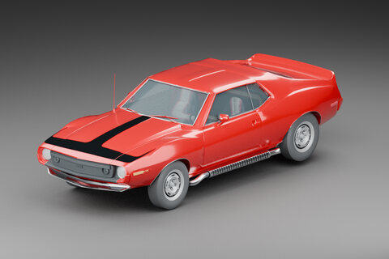
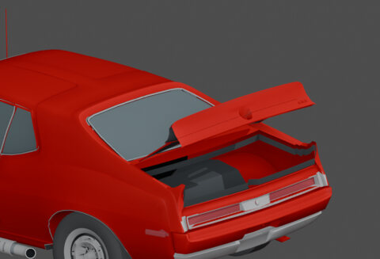
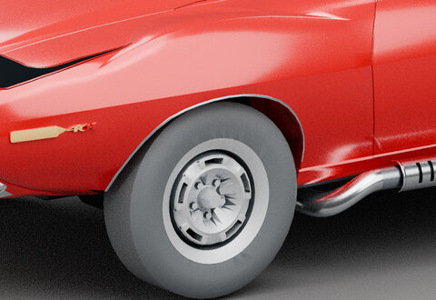

# DSI Javelin 1973

A reusable, editable **1973 AMC Javelin AMX Pierre Cardin vehicle asset** by Dead Signal Interactive. Private development repository. The vehicle is the product; game integrations are separate, checkpoint-specific delivery lanes.

**Current source: V41-based outer-tire contour, Library 36.** Existing original render of the exact adopted bytes, not a new render or in-game acceptance. [Enter the visual gallery →](current-work/gallery/README.md)

[Current asset](current-work/README.md) · [Status and gates](docs/project-status.md) · [Artifact manifest](current-work/artifact-manifest.json) · [Project specification](SPEC.md) · [Real-car research](docs/research-index.md)

## Walk through the Javelin

Six linked exhibits, 20 original renders. Open a room, then follow its individual images, before/after pairs, source cards and back/next links. Historical work is labeled separately from current source.

<table>
<tr><td align="center"> <a href="current-work/gallery/01-whole-car.md"><b>01 · The whole car</b></a> Current source + history</td><td align="center"> <a href="current-work/gallery/02-body.md"><b>02 · Body construction</b></a> Historical development</td></tr>
<tr><td align="center"> <a href="current-work/gallery/03-panels.md"><b>03 · Panels and ownership</b></a> Historical development</td><td align="center"> <a href="current-work/gallery/04-wheels.md"><b>04 · Wheels and tires</b></a> Current source + history</td></tr>
<tr><td align="center"> <a href="current-work/gallery/05-trim.md"><b>05 · Brightwork and lamps</b></a> Historical development</td><td align="center"> <a href="current-work/gallery/06-interior.md"><b>06 · Inside the cabin</b></a> Historical development</td></tr>
</table>

[Start with the whole car →](current-work/gallery/01-whole-car.md) · [Gallery evidence](current-work/gallery/evidence.md)

## Project direction

Develop one canonical editable Javelin, preserving the user-owned STL body authority, accepted cockpit, original project artwork and prior checkpoints. Improve visual likeness, body construction, panel separation, wheel/tire presentation, materials and reusable source organization. Do not add unnecessary underneath structure; preserved optional underside work is not automatic export authority.

**Current cloud authoring authority: V41**, identified by the [exact artifact manifest](current-work/artifact-manifest.json). The reviewed outer-tire candidate was adopted without a further geometry edit; the prior canonical checkpoint remains preserved. Adoption is not whole-vehicle visual approval, continuous-clearance proof or universal engine readiness.

The current `.blend` remains external to this Git tree. **A clone does not contain V41** or the complete cloud development archive. Older files under `assets/current-stl/`, `assets/Javelin73PC.blend` and `Javelin73PC/` remain historical work, not current-model authority.

## Asset and integration gates

<table>
<tr><th>Lane</th><th>Current boundary</th></tr>
<tr><td>Canonical editable asset</td><td>V41 cloud source; reference-driven visual refinement and source verification remain separate from runtime tests</td></tr>
<tr><td>Wreckfest</td><td>Active integration lane owned by Claude. User screenshot confirms patched V40 with the temporary 158 donor-sphere workaround reaches the garage, not driving or physics acceptance</td></tr>
<tr><td>Project Zomboid</td><td>Preserved historical integration and research. Earlier package receipts do not validate V41; no current port is claimed</td></tr>
<tr><td>Other engines or uses</td><td>Potential reuse only. Each target needs its own scale, axes, materials, rig/collision, import, performance and runtime acceptance</td></tr>
</table>

Wreckfest's route is **Blender / the existing writer → official `bgeometry` tooling**. 3ds Max is not a project requirement. The garage observation does not establish a complete supported workflow for every edition, export variant or checkpoint. [Integration evidence and remaining gates](docs/integration-status.md).

## Project map

<table>
<tr><th>Location</th><th>Purpose</th></tr>
<tr><td><a href="current-work/README.md">Current work</a></td><td>Canonical source identity, adoption limits, historical images and next asset-review gates</td></tr>
<tr><td><a href="docs/project-status.md">Project status</a></td><td>Portable takeover entry point and independent lane status</td></tr>
<tr><td><a href="docs/research-index.md">Real-car research</a></td><td>Factory dimensions, target observations, photographs, citations and disagreements</td></tr>
<tr><td><a href="assets/current-stl/">Historical STL snapshot</a></td><td>Preserved older editable assembly, not the current cloud binary</td></tr>
<tr><td><a href="Javelin73PC/">Historical PZ package</a></td><td>Earlier procedural runtime work and its original identifiers</td></tr>
<tr><td><a href="camera/verification.md">Camera 0.1.1</a></td><td>Independent zoom candidate; full 3D gameplay rotation remains unproven research</td></tr>
<tr><td><a href="fast-load/README.md">Fast Load 0.0.8</a></td><td>Independent and explicitly untested; no automatic save loading or measured speedup</td></tr>
<tr><td><a href="AGENTS.md">Project guidance</a></td><td>Scope, ownership, preservation and DOX contracts</td></tr>
</table>

## Getting oriented

1. Read [status](docs/project-status.md), root [AGENTS.md](AGENTS.md) and applicable child contracts.
2. Resolve the exact current artifact from the [manifest](current-work/artifact-manifest.json) using owner-authorized access. Verify its hash before authoring or export; old filenames do not establish authority.
3. Choose the asset task or a specific integration lane. Record the exact source, target and evidence limits before any separately authorized execution.

`tools/build_mod.py` rebuilds the historical procedural PZ model, not V41. Existing game/tool installations, profiles and private Library files are external prerequisites. Documentation housekeeping is not export, game-launch, installation or public-release authority.

## Provenance and history

Keep real-car research, source disagreements, prior failures and rejected experiments tied to their original checkpoints. External photographs, literature and video are references, not automatically redistributable assets. The unrelated old Javelin mod is technical reference only. Preserve all required license notices.

[Target video](https://www.youtube.com/watch?v=ZpfnHMBiRvA) · [Historical project artwork, prior model](readme-banner.png) · [Historical artwork brief](readme-banner-prompt.txt) · [DOX MIT notice](docs/licenses/DOX-MIT.txt) · [Changelog](CHANGELOG.md)

