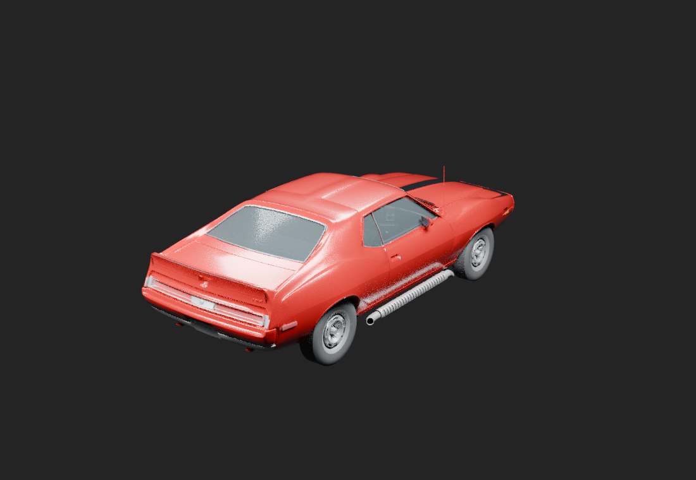

# Current editable vehicle asset

Snapshot: **2026-10-29**. Project: **DSI Javelin 1973**, a reusable editable vehicle asset with independent integration gates.

[Explore the linked visual gallery →](gallery/README.md) · [Current whole-car render](gallery/works/current-whole-car.md)

## Current source and adoption

Current cloud authority is the **V41-based outer-front-tire contour checkpoint, Library version 36**, stored as `DSI_Javelin_Current_Cloud_Model.blend`.

- SHA-256: `aad667f38b8c7a449b0ea148cefa2a71b0c6eecfd568ad2e5c5b6808e8d06289`
- Size: **39,160,325 bytes**
- Stable Library identity: `libfile_dc7967b8d0088191ad558887bc71a3dd`
- [Exact artifact manifest](artifact-manifest.json) · [Portable adoption evidence](receipts/outer-front-tire-adoption-library36.json)

The exact reviewed outer-tire candidate was adopted without a further native rebuild/save or geometry edit. The adoption receipt was inspected; canonical file, immutable milestone and downloaded Library readback were independently matched by hash and size. The prior canonical conformal-trim checkpoint remains preserved as Library version 35 and immutable history.

The adoption concerns **400 central faces per front tire only**. The reviewed identity preserves original 309/310 collars, old points, beads, rim, arch, rig and unrelated assets. It is a limited outer-contour improvement, not whole-tire or whole-model approval and not an 80% acceptance claim. The failed outboard-collar family and rear R57 remain parked. Inner sidewall/guard triangular shading, coarse rim/hub spikes, blank tread/rubber finish and unchanged rear tires remain open; the intended AMX finish is unresolved.

**The current binary is external to this repository. A clone does not contain it or the complete cloud development archive.** Use owner-authorized artifact access and verify identity before authoring or export. This index publishes no private download links.

## Asset work and gates

Continue reference-driven visual refinement of the canonical editable vehicle, body/panel construction and source organization. Preserve user-owned STL authority, accepted cockpit, original floor/tunnel and side pipes, artwork, research and prior checkpoints. Do not add unnecessary underneath structure; optional hidden/export-excluded modules remain history unless specifically adopted.

1. Bind every task to the exact accepted source and keep parked/rejected work inactive.
2. Review source geometry, normals, seams/ownership, material references and panel/wheel motion with their actual scope and sample limits.
3. Compare actual source images against the target in matched and complementary views. Adoption and finite checks do not close likeness, whole-car quality or continuous-clearance gates.
4. Treat target export/import and native appearance, driving, physics/damage and persistence as independent gates. No universal engine-ready claim.
5. Keep model work separate from repository housekeeping and Claude's current Wreckfest runtime fix.

[Project specification](../SPEC.md) · [Integration status and historical failures](../docs/integration-status.md) · [Real-car research](../docs/research-index.md).

## Historical images and evidence

These existing images depict **BodyOnly V03 on 2026-10-27**, not current V41. They remain for continuity only. They are actual authoring renders, not in-game screenshots or final likeness approval. The owner subsequently authorized a curated original-render gallery. Its [current-source render](gallery/works/current-whole-car.md), historical exhibits and [image manifest](gallery/image-manifest.json) remain separately labeled; no fresh render or model change was needed.

The [original V03 receipt](receipts/body-only-v03-preservation.json) retains its 15 preservation/scope checks. V03 hid/excluded optional new underside work, restored original floor/tunnel and preserved original pipe pieces without adding/deleting raw geometry. Those results belong to V03, not V41.

## Artifact and history map

| Artifact | Role |
| --- | --- |
| Library version 36, exact hash above | Current V41-based limited outer-tire contour source |
| V41 conformal front-arch trim, Library version 35 | Preserved previous canonical checkpoint, not the current pointer |
| BodyOnly V03, Library version 2 | Historical scope/preservation checkpoint and existing images |
| Prior source, optional underside, collar/R57 work | Preserved history or parked work; not automatically adopted/exportable |
| `assets/current-stl/Javelin73PC-current.blend` | Historical Git-stored STL assembly; filename does not make it current |
| `assets/Javelin73PC.blend`, `Javelin73PC/` | Earlier procedural source/PZ package, preserved unchanged |

Wreckfest patched-V40 garage-load evidence is separate from this authoring adoption and does not validate V41. Earlier PZ import/native records also remain checkpoint-specific. No model, script, exporter, package or runtime change is part of this documentation-only refresh.
