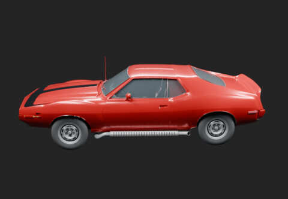
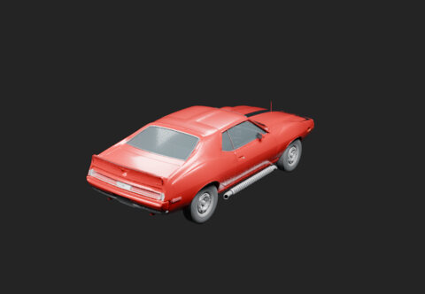

# 01 · The whole car

[Back to repository](../../README.md) · [Gallery foyer](README.md) · [Next: Body construction](02-body.md)

Start with the exact current source, then step back to clearly marked V03 side and rear views. The historical views are not a matched before/after of the current car.

**Current source, Library 36.** Open the render card for the exact hash and scope.

## Earlier silhouettes

<table>
<tr><td align="center"> <a href="works/v03-side.md"><b>Historical side silhouette</b></a> <small>HISTORICAL · BodyOnly V03</small></td><td align="center"> <a href="works/v03-rear.md"><b>Historical rear-quarter silhouette</b></a> <small>HISTORICAL · BodyOnly V03</small></td></tr>
</table>

Click a thumbnail for the individual render and its source record. Gallery indexed 2026-10-29; exact original render timestamps are unrecorded.

[Evidence and source limits](evidence.md) · [Image manifest](image-manifest.json)

[Back to repository](../../README.md) · [Gallery foyer](README.md) · [Next: Body construction](02-body.md)

