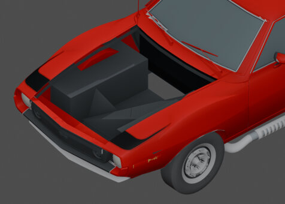
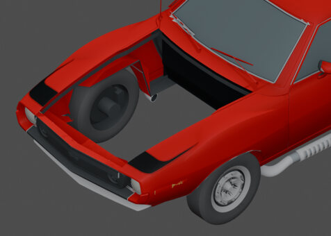

# 02 · Body construction

[Previous: The whole car](01-whole-car.md) · [Gallery foyer](README.md) · [Next: Panels and ownership](03-panels.md)

A focused historical bay repair. Compare the intersecting geometry before correction with the bounded V04 repair, with the hood hidden for inspection.

<table>
<tr><td align="center"> <a href="works/body-bay-before.md"><b>Before: intersecting front-bay geometry</b></a> <small>HISTORICAL · BodyOnly V03 before V04 repair</small></td><td align="center"> <a href="works/body-bay-after.md"><b>After: minimal front-body repair</b></a> <small>HISTORICAL · V04 reviewed repair candidate</small></td></tr>
</table>

Click a thumbnail for the individual render and its source record. Gallery indexed 2026-10-29; exact original render timestamps are unrecorded.

[Evidence and source limits](evidence.md) · [Image manifest](image-manifest.json)

[Previous: The whole car](01-whole-car.md) · [Gallery foyer](README.md) · [Next: Panels and ownership](03-panels.md)

