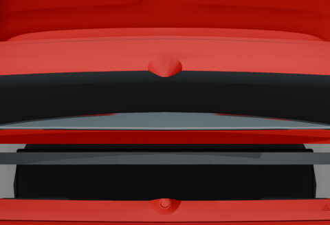
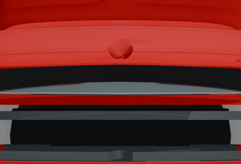
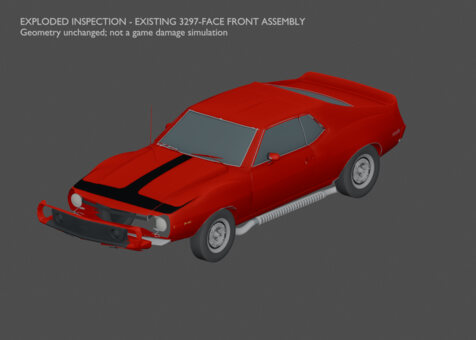

# 03 · Panels and ownership

[Previous: Body construction](02-body.md) · [Gallery foyer](README.md) · [Next: Wheels and tires](04-wheels.md)

Follow the trunk bowl through a historical ownership correction, then look at the original front assembly separated for inspection.

<table>
<tr><td align="center"> <a href="works/trunk-bowl-before.md"><b>Before: split trunk bowl</b></a> <small>HISTORICAL · V24 source before V25</small></td><td align="center"> <a href="works/trunk-bowl-after.md"><b>After: complete moving trunk bowl</b></a> <small>HISTORICAL · V25 final 605-face ownership</small></td></tr>
<tr><td align="center"> <a href="works/trunk-open.md"><b>Open trunk and rear skin</b></a> <small>HISTORICAL · V25 final 605-face ownership</small></td><td align="center"> <a href="works/front-assembly-exploded.md"><b>How the front assembly separates</b></a> <small>HISTORICAL · V10 front-fascia source assembly</small></td></tr>
</table>

Click a thumbnail for the individual render and its source record. Gallery indexed 2026-10-29; exact original render timestamps are unrecorded.

[Evidence and source limits](evidence.md) · [Image manifest](image-manifest.json)

[Previous: Body construction](02-body.md) · [Gallery foyer](README.md) · [Next: Wheels and tires](04-wheels.md)

