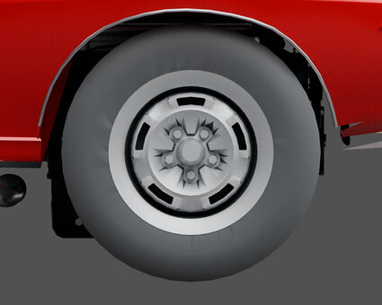
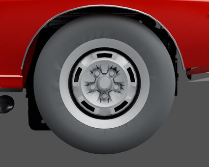
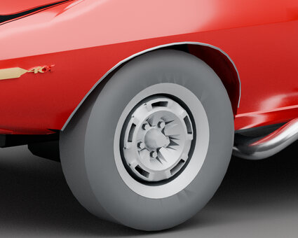
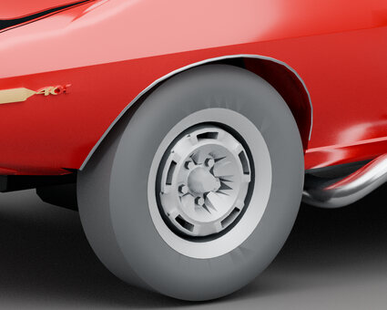

# 04 · Wheels and tires

[Previous: Panels and ownership](03-panels.md) · [Gallery foyer](README.md) · [Next: Brightwork and lamps](05-trim.md)

Matched views show the adopted outer-front-tire contour improvement. The rim, inner shading, tread finish and rear tires remain unfinished.

<table>
<tr><td align="center"> <a href="works/right-wheel-side-before.md"><b>Before: right wheel side</b></a> <small>HISTORICAL · V41 conformal trim / Library 35</small></td><td align="center"> <a href="works/right-wheel-side-after.md"><b>After: right wheel side</b></a> <small>CURRENT SOURCE BYTES · V41-based outer-tire contour / Library 36</small></td></tr>
<tr><td align="center"> <a href="works/left-wheel-oblique-before.md"><b>Before: left wheel oblique</b></a> <small>HISTORICAL · V41 conformal trim / Library 35</small></td><td align="center"> <a href="works/left-wheel-oblique-after.md"><b>After: left wheel oblique</b></a> <small>CURRENT SOURCE BYTES · V41-based outer-tire contour / Library 36</small></td></tr>
</table>

Click a thumbnail for the individual render and its source record. Gallery indexed 2026-10-29; exact original render timestamps are unrecorded.

[Evidence and source limits](evidence.md) · [Image manifest](image-manifest.json)

[Previous: Panels and ownership](03-panels.md) · [Gallery foyer](README.md) · [Next: Brightwork and lamps](05-trim.md)

