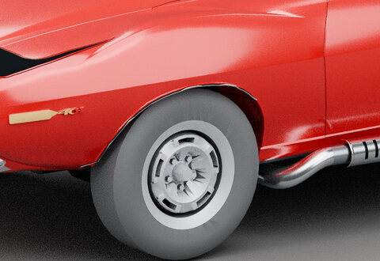
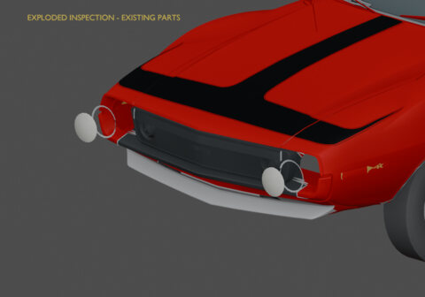

# 05 · Brightwork and lamps

[Previous: Wheels and tires](04-wheels.md) · [Gallery foyer](README.md) · [Next: Inside the cabin](06-interior.md)

Inspect a historical front-arch fit correction and the separate existing headlamp pieces. Exploded offsets are inspection aids, not game damage.

<table>
<tr><td align="center"> <a href="works/arch-trim-before.md"><b>Before: restored pre-fit arch-strip placement</b></a> <small>HISTORICAL · V41 conformal front-arch trim / Library 35</small></td><td align="center"> <a href="works/arch-trim-after.md"><b>After: conformal arch brightwork</b></a> <small>HISTORICAL · V41 conformal front-arch trim / Library 35</small></td></tr>
<tr><td align="center"> <a href="works/headlamp-exploded.md"><b>Inside the headlamp assembly</b></a> <small>HISTORICAL · V07 existing headlamp bezels</small></td></tr>
</table>

Click a thumbnail for the individual render and its source record. Gallery indexed 2026-10-29; exact original render timestamps are unrecorded.

[Evidence and source limits](evidence.md) · [Image manifest](image-manifest.json)

[Previous: Wheels and tires](04-wheels.md) · [Gallery foyer](README.md) · [Next: Inside the cabin](06-interior.md)

