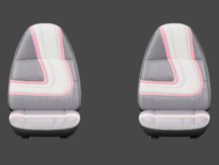
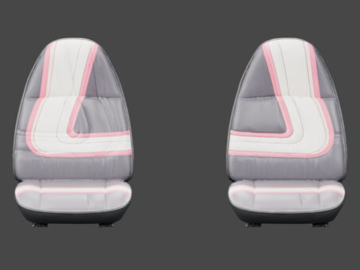
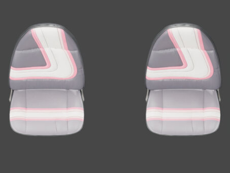
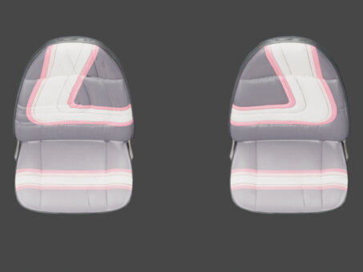

# 06 · Inside the cabin

[Previous: Brightwork and lamps](05-trim.md) · [Gallery foyer](README.md) · [Return to gallery foyer](README.md)

Historical front and overhead pairs show the passenger-seat motif reversal. These isolated seat renders do not stand in for a current full-cabin review.

<table>
<tr><td align="center"> <a href="works/seat-front-before.md"><b>Before: front-seat motifs</b></a> <small>HISTORICAL · V26 source before V27</small></td><td align="center"> <a href="works/seat-front-after.md"><b>After: front-seat motifs</b></a> <small>HISTORICAL · V27 adopted passenger-seat design</small></td></tr>
<tr><td align="center"> <a href="works/seat-overhead-before.md"><b>Before: seat motifs from above</b></a> <small>HISTORICAL · V26 source before V27</small></td><td align="center"> <a href="works/seat-overhead-after.md"><b>After: seat motifs from above</b></a> <small>HISTORICAL · V27 adopted passenger-seat design</small></td></tr>
</table>

Click a thumbnail for the individual render and its source record. Gallery indexed 2026-10-29; exact original render timestamps are unrecorded.

[Evidence and source limits](evidence.md) · [Image manifest](image-manifest.json)

[Previous: Brightwork and lamps](05-trim.md) · [Gallery foyer](README.md) · [Return to gallery foyer](README.md)

