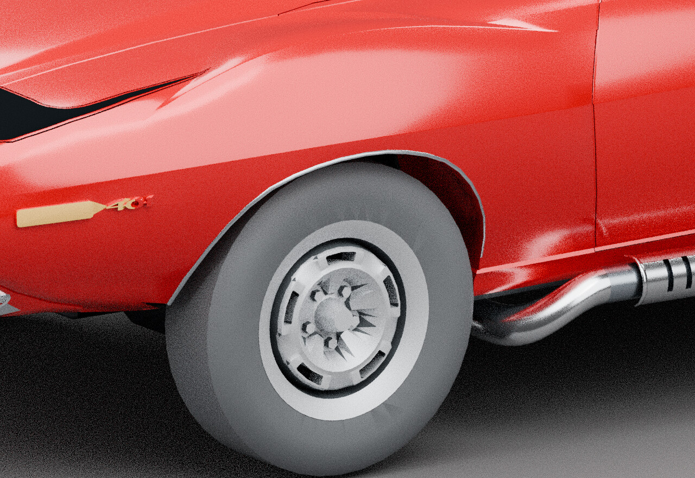

# After: conformal arch brightwork

[← Previous render](arch-trim-before.md) · [Back to Brightwork and lamps](../05-trim.md) · [Next render →](headlamp-exploded.md)

**HISTORICAL** · V41 conformal front-arch trim / Library 35  
**Record set:** 2026-10-28 · **Original render timestamp:** unrecorded · **Gallery index:** 2026-10-29

Matched oblique views of front brightwork source-fit correction.

**What this shows and does not show:** Before restores source strips in memory under the same camera; it is not a separate earlier full saved model. Painted crown, tire/rim, badge and marker defects remain. No factory mounting or game proof.

[Open larger display image](../images/views/arch-trim-after.jpg) · [Compare before](arch-trim-before.md) · [Evidence](../evidence.md#trim-v41)

## Source card

- Original authored PNG: `conformal-v02-candidate-left-oblique.png`
- Source model SHA-256: `c02959f309a8b039bf110fc745a0ff8efa353dcb1f79a510e30f99f14108c10e`
- Original PNG SHA-256: `1cfc5ffbd0d743bb86a44980379b651f1652e4338dce8f52309a8920dfe0c1b6`
- Inspected record: `SAVED_V41V02_VIEWS.json`
- Actual original authored-car render; before is a memory-only source-placement comparison within the recorded V41 review.

The linked JPEG is a metadata-stripped display derivative, not a pixel-identical measurement artifact. [Source, display and thumbnail hashes](../image-manifest.json).

[← Previous render](arch-trim-before.md) · [Gallery foyer](../README.md) · [Next render →](headlamp-exploded.md)
