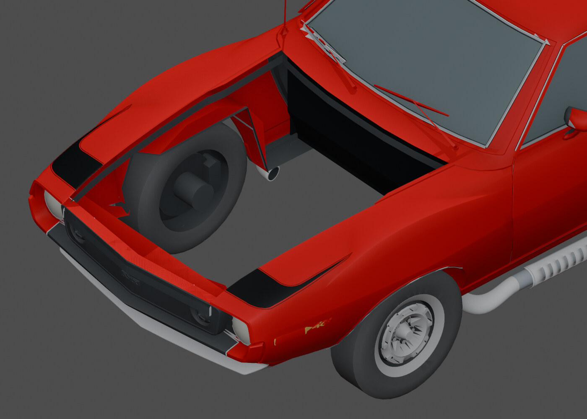

# After: minimal front-body repair

[← Previous render](body-bay-before.md) · [Back to Body construction](../02-body.md) · [Next render →](trunk-bowl-before.md)

**HISTORICAL** · V04 reviewed repair candidate  
**Record set:** 2026-10-27 · **Original render timestamp:** unrecorded · **Gallery index:** 2026-10-29

Existing body geometry corrected with the hood hidden for inspection; this is not an engine installation.

**What this shows and does not show:** After render source differs from adopted V04 only by hidden archive export-exclusion metadata. Source manifest and successful historical delivery identify the pair; original image hashes were recorded at gallery curation, not supplied by that source manifest. No extra underneath structure or full-car completion claim.

[Open larger display image](../images/views/body-bay-after.jpg) · [Compare before](body-bay-before.md) · [Evidence](../evidence.md#v04)

## Source card

- Original authored PNG: `V04-body-repair-after-bay.png`
- Source model SHA-256: `7be4e9aea23dbdab5fdd33986088e60bf6f300106040b4831a00ae11999d2552`
- Original PNG SHA-256: `0c4fa6a6b8fc5cb768948dee3fc65fadda31b382b892d279a02d042de3a7e569`
- Inspected record: `V04_VISUAL_SOURCE_MANIFEST.json`
- Actual original authored-car render; not a game screenshot or third-party photograph.
- This source manifest does not carry the original PNG hash. The historical delivery identifies the file; its pixels were inspected and its original-byte hash recorded at gallery curation.

The linked JPEG is a metadata-stripped display derivative, not a pixel-identical measurement artifact. [Source, display and thumbnail hashes](../image-manifest.json).

[← Previous render](body-bay-before.md) · [Gallery foyer](../README.md) · [Next render →](trunk-bowl-before.md)
