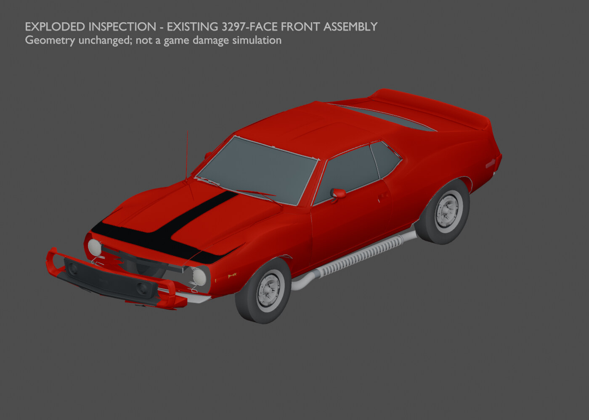

# How the front assembly separates

[← Previous render](trunk-open.md) · [Back to Panels and ownership](../03-panels.md) · [Next render →](right-wheel-side-before.md)

**HISTORICAL** · V10 front-fascia source assembly  
**Record set:** 2026-10-27 · **Original render timestamp:** unrecorded · **Gallery index:** 2026-10-29

Existing 3,297-face front assembly translated forward in memory for an exploded inspection.

**What this shows and does not show:** Inspection offsets only. Geometry and closed placement were not changed; this is not a saved assembly pose, an animation or a damage simulation.

[Open larger display image](../images/views/front-assembly-exploded.jpg) · [Evidence](../evidence.md#v10)

## Source card

- Original authored PNG: `V10-existing-front-assembly-exploded.png`
- Source model SHA-256: `8c3c4764890d9cbca4c665bf893e1bbbb56cf66a92a0eca8084596c6ab4fba9f`
- Original PNG SHA-256: `7864e703e11ee7bcec1e6fafcaf05ad39c4db31b052745eba950a6050585cd7a`
- Inspected record: `V10_VISUAL_SOURCE_MANIFEST.json`
- Actual original authored-car render; not a game screenshot or third-party photograph.

The linked JPEG is a metadata-stripped display derivative, not a pixel-identical measurement artifact. [Source, display and thumbnail hashes](../image-manifest.json).

[← Previous render](trunk-open.md) · [Gallery foyer](../README.md) · [Next render →](right-wheel-side-before.md)
