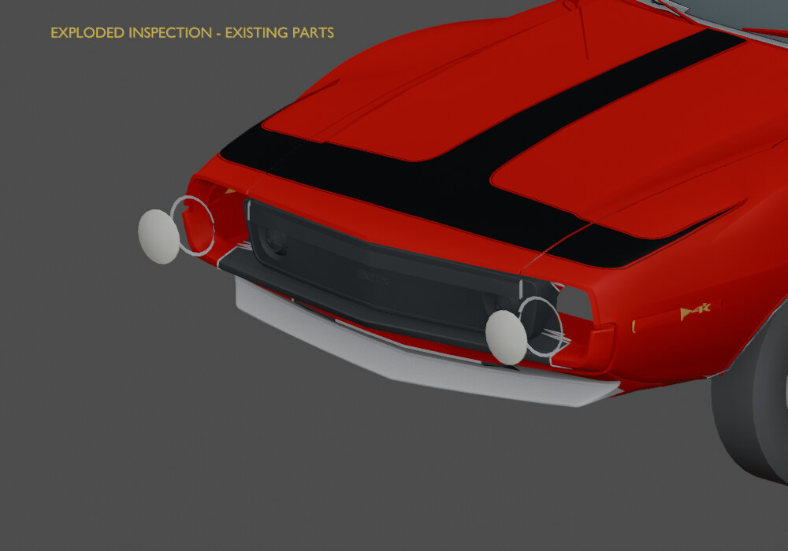

# Inside the headlamp assembly

[← Previous render](arch-trim-after.md) · [Back to Brightwork and lamps](../05-trim.md) · [Next render →](seat-front-before.md)

**HISTORICAL** · V07 existing headlamp bezels  
**Record set:** 2026-10-27 · **Original render timestamp:** unrecorded · **Gallery index:** 2026-10-29

Existing lenses and bezels offset in memory to reveal their separate ownership.

**What this shows and does not show:** Not new fixtures, game damage or a saved open/exploded assembly. Original geometry was not added by this inspection.

[Open larger display image](../images/views/headlamp-exploded.jpg) · [Evidence](../evidence.md#v07)

## Source card

- Original authored PNG: `V07-existing-headlamp-parts-exploded.png`
- Source model SHA-256: `0c352019c60d29feb22315ead3664aba33cac9b873da8946c390a1fdccb1e370`
- Original PNG SHA-256: `0faa8c81a45b2c0c2029cdc507f7531cb5f47736d3608572a32355a372336308`
- Inspected record: `V07_VISUAL_SOURCE_MANIFEST.json`
- Actual original authored-car render; not a game screenshot or third-party photograph.

The linked JPEG is a metadata-stripped display derivative, not a pixel-identical measurement artifact. [Source, display and thumbnail hashes](../image-manifest.json).

[← Previous render](arch-trim-after.md) · [Gallery foyer](../README.md) · [Next render →](seat-front-before.md)
