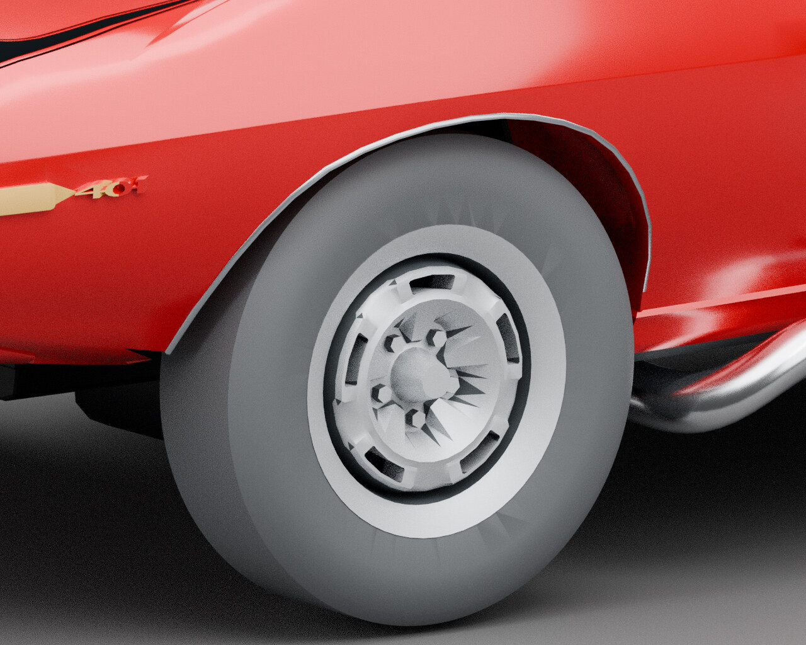

# After: left wheel oblique

[← Previous render](left-wheel-oblique-before.md) · [Back to Wheels and tires](../04-wheels.md) · [Next render →](arch-trim-before.md)

**CURRENT SOURCE BYTES** · V41-based outer-tire contour / Library 36  
**Record set:** 2026-10-29 · **Original render timestamp:** unrecorded · **Gallery index:** 2026-10-29

Matched camera and lighting isolate the smoother outer circumference. The adopted after image shows the exact current source bytes.

**What this shows and does not show:** Only 400 central facets per front tire were replaced. Inner-sidewall/guard shading, coarse rim/hub spikes, blank tread/rubber finish and rear tires remain open. Not whole-tire or whole-model approval.

[Open larger display image](../images/views/left-wheel-oblique-after.jpg) · [Compare before](left-wheel-oblique-before.md) · [Evidence](../evidence.md#current-tires)

## Source card

- Original authored PNG: `candidate-left-wheel-oblique.png`
- Source model SHA-256: `aad667f38b8c7a449b0ea148cefa2a71b0c6eecfd568ad2e5c5b6808e8d06289`
- Original PNG SHA-256: `60fd027cfa9246e9f7cb2ca6715f39168e80d974f3474e37018352ed2250a854`
- Inspected record: `candidate-left-wheel-oblique.json`
- Actual original authored-car render; not a game screenshot or third-party photograph.

The linked JPEG is a metadata-stripped display derivative, not a pixel-identical measurement artifact. [Source, display and thumbnail hashes](../image-manifest.json).

[← Previous render](left-wheel-oblique-before.md) · [Gallery foyer](../README.md) · [Next render →](arch-trim-before.md)
