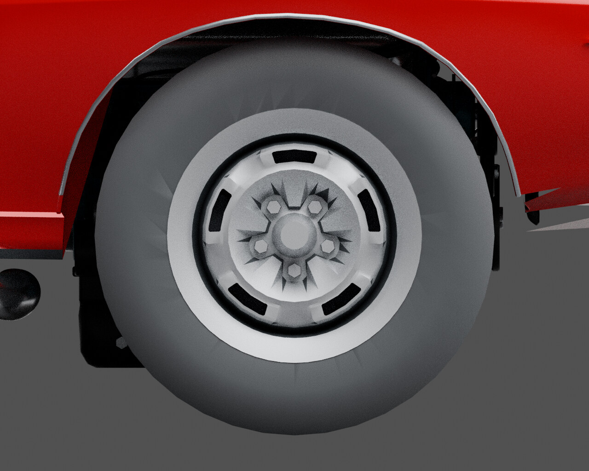

# Before: right wheel side

[← Previous render](front-assembly-exploded.md) · [Back to Wheels and tires](../04-wheels.md) · [Next render →](right-wheel-side-after.md)

**HISTORICAL** · V41 conformal trim / Library 35  
**Record set:** 2026-10-29 · **Original render timestamp:** unrecorded · **Gallery index:** 2026-10-29

Matched camera and lighting isolate the smoother outer circumference. The adopted after image shows the exact current source bytes.

**What this shows and does not show:** Only 400 central facets per front tire were replaced. Inner-sidewall/guard shading, coarse rim/hub spikes, blank tread/rubber finish and rear tires remain open. Not whole-tire or whole-model approval.

[Open larger display image](../images/views/right-wheel-side-before.jpg) · [Compare after](right-wheel-side-after.md) · [Evidence](../evidence.md#current-tires)

## Source card

- Original authored PNG: `source-right-wheel-side.png`
- Source model SHA-256: `c02959f309a8b039bf110fc745a0ff8efa353dcb1f79a510e30f99f14108c10e`
- Original PNG SHA-256: `4f9c84075e760d3c1be27cc27577f1c3241b28da873dd0da51c8088ebfd9f1b4`
- Inspected record: `source-right-wheel-side.json`
- Actual original authored-car render; not a game screenshot or third-party photograph.

The linked JPEG is a metadata-stripped display derivative, not a pixel-identical measurement artifact. [Source, display and thumbnail hashes](../image-manifest.json).

[← Previous render](front-assembly-exploded.md) · [Gallery foyer](../README.md) · [Next render →](right-wheel-side-after.md)
