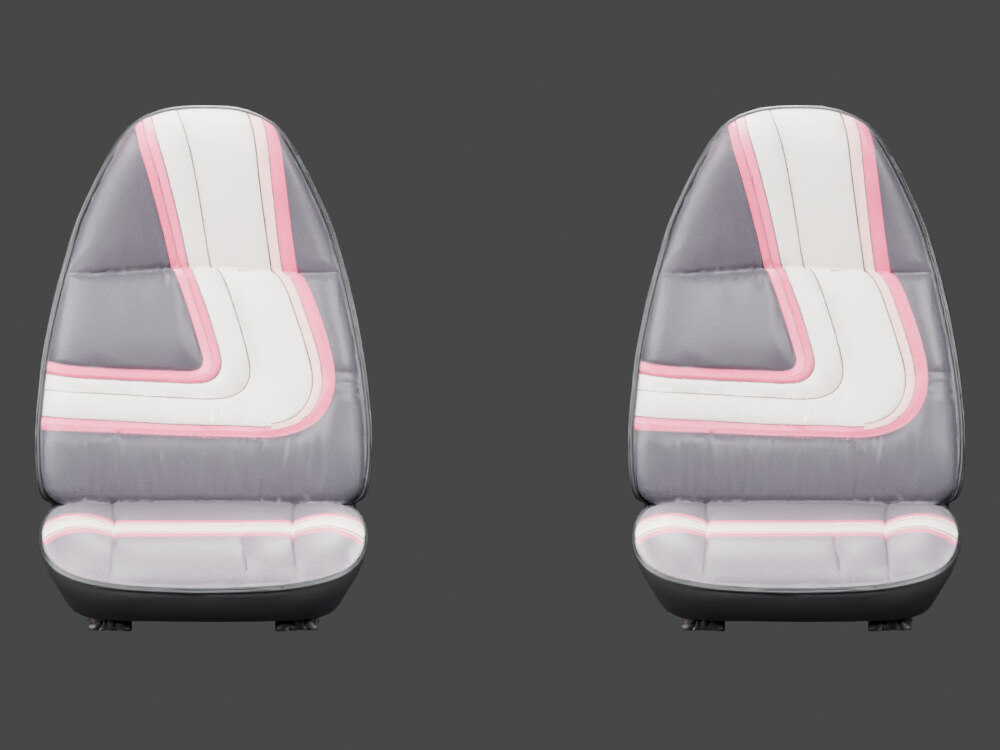

# Before: front-seat motifs

[← Previous render](headlamp-exploded.md) · [Back to Inside the cabin](../06-interior.md) · [Next render →](seat-front-after.md)

**HISTORICAL** · V26 source before V27  
**Record set:** 2026-10-28 · **Original render timestamp:** unrecorded · **Gallery index:** 2026-10-29

Passenger seat is image-left. V27 reverses its design so both vertical bands sit outboard; the original driver design is preserved.

**What this shows and does not show:** Texture/material design correction on unchanged seat geometry. Finite projection over an asymmetric seat, not exact spatial pixel reflection, full-cabin completion or a current-source cabin render.

[Open larger display image](../images/views/seat-front-before.jpg) · [Compare after](seat-front-after.md) · [Evidence](../evidence.md#v27)

## Source card

- Original authored PNG: `V27-before-passenger-seat-design-front.png`
- Source model SHA-256: `38154b89da01bdfc7f662ba18f0708fa6f1160399128e4ab46d03a4a429000f4`
- Original PNG SHA-256: `ceae1b38be456487561c1bd03c231bb34af72aed56e8a7ab3f874a671e8d43f6`
- Inspected record: `independent-final-view-review.json`
- Actual original authored-car render; not a game screenshot or third-party photograph.

The linked JPEG is a metadata-stripped display derivative, not a pixel-identical measurement artifact. [Source, display and thumbnail hashes](../image-manifest.json).

[← Previous render](headlamp-exploded.md) · [Gallery foyer](../README.md) · [Next render →](seat-front-after.md)
