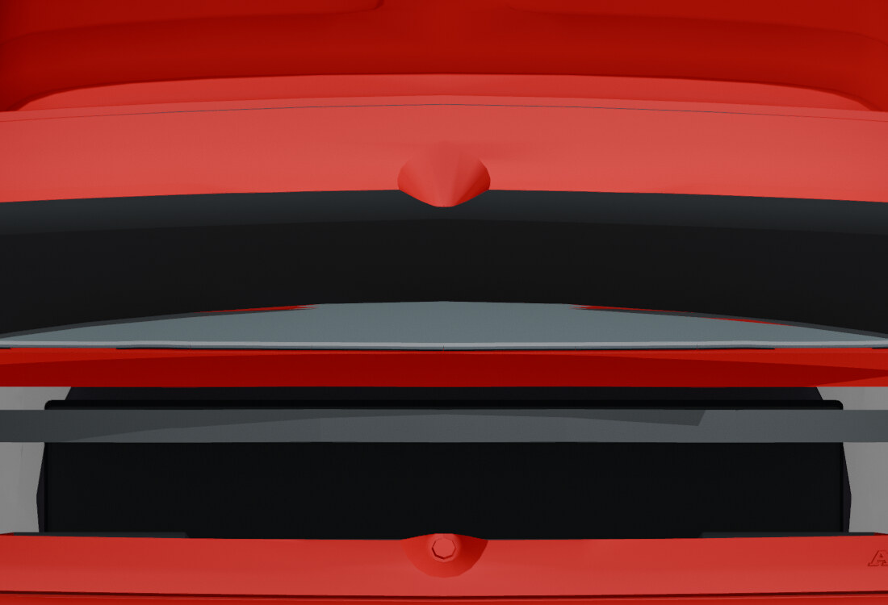

# Before: split trunk bowl

[← Previous render](body-bay-after.md) · [Back to Panels and ownership](../03-panels.md) · [Next render →](trunk-bowl-after.md)

**HISTORICAL** · V24 source before V25  
**Record set:** 2026-10-28 · **Original render timestamp:** unrecorded · **Gallery index:** 2026-10-29

Historical panel-ownership inspection at the recorded open pose. The final V25 moves the complete visible bowl and rear skin with the trunk.

**What this shows and does not show:** Workbench material preview, not PBR beauty, factory construction, continuous swept clearance or native damage. The rejected 595-face trial is excluded.

[Open larger display image](../images/views/trunk-bowl-before.jpg) · [Compare after](trunk-bowl-after.md) · [Evidence](../evidence.md#v25)

## Source card

- Original authored PNG: `V25-before-split-trunk-bowl.png`
- Source model SHA-256: `6a157345318acb46dc56021876084a96854b71e7f2e525cdf6a1260f9fcfc8b2`
- Original PNG SHA-256: `c4a6a1540a1d2e361aae850e25949af004705f6eaad3c6dbea0d4556bdbe18dd`
- Inspected record: `review-view-manifest.json`
- Actual original authored-car render; not a game screenshot or third-party photograph.

The linked JPEG is a metadata-stripped display derivative, not a pixel-identical measurement artifact. [Source, display and thumbnail hashes](../image-manifest.json).

[← Previous render](body-bay-after.md) · [Gallery foyer](../README.md) · [Next render →](trunk-bowl-after.md)
