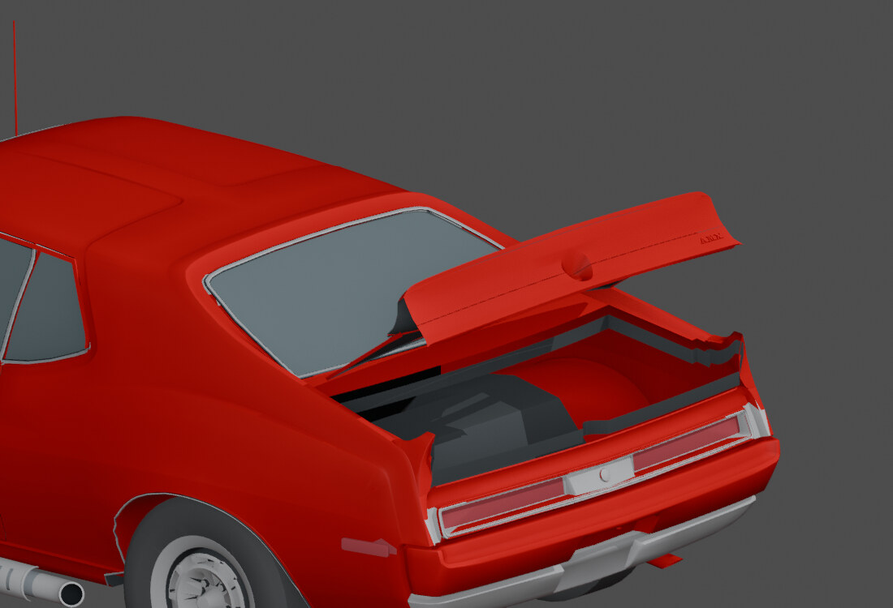

# Open trunk and rear skin

[← Previous render](trunk-bowl-after.md) · [Back to Panels and ownership](../03-panels.md) · [Next render →](front-assembly-exploded.md)

**HISTORICAL** · V25 final 605-face ownership  
**Record set:** 2026-10-28 · **Original render timestamp:** unrecorded · **Gallery index:** 2026-10-29

Historical panel-ownership inspection at the recorded open pose. The final V25 moves the complete visible bowl and rear skin with the trunk.

**What this shows and does not show:** Workbench material preview, not PBR beauty, factory construction, continuous swept clearance or native damage. The rejected 595-face trial is excluded.

[Open larger display image](../images/views/trunk-open.jpg) · [Evidence](../evidence.md#v25)

## Source card

- Original authored PNG: `V25-trunk-rear-skin-open-preview.png`
- Source model SHA-256: `51ef61817a5ff4019ae2a80a89f42ab504e33834b7b4cb5e772e480ec999adac`
- Original PNG SHA-256: `c6172c8c3cfe1185a35e3ab6591ed03a8899b0ce0093e7e9812d2b45e12bc4bb`
- Inspected record: `review-view-manifest.json`
- Actual original authored-car render; not a game screenshot or third-party photograph.

The linked JPEG is a metadata-stripped display derivative, not a pixel-identical measurement artifact. [Source, display and thumbnail hashes](../image-manifest.json).

[← Previous render](trunk-bowl-after.md) · [Gallery foyer](../README.md) · [Next render →](front-assembly-exploded.md)
