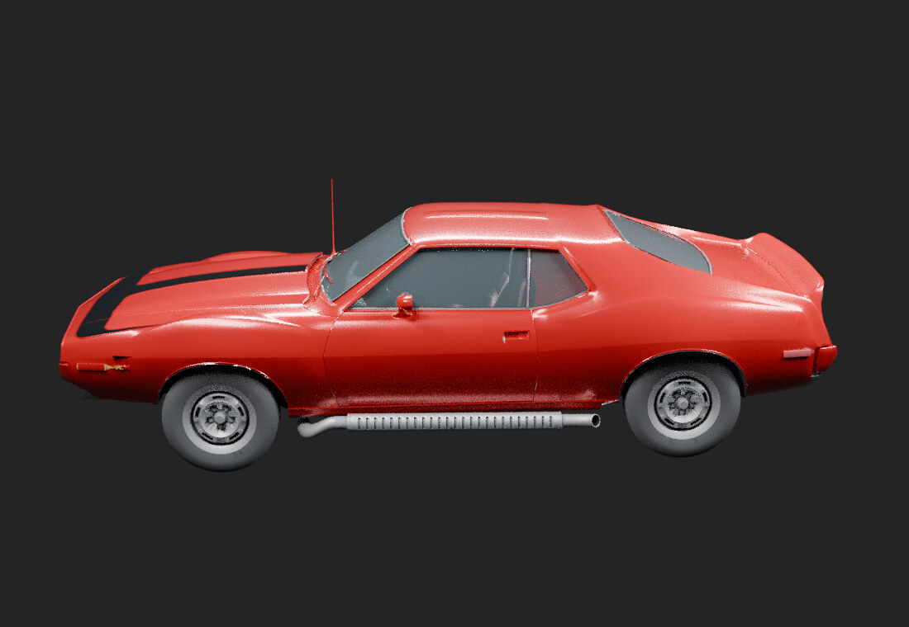

# Historical side silhouette

[← Previous render](current-whole-car.md) · [Back to The whole car](../01-whole-car.md) · [Next render →](v03-rear.md)

**HISTORICAL** · BodyOnly V03  
**Record set:** 2026-10-27 · **Original render timestamp:** unrecorded · **Gallery index:** 2026-10-29

Historical V03 exterior view retained as a separate checkpoint, not a current-model photograph.

**What this shows and does not show:** Visibility/export-exclusion milestone only. Geometry repair and native acceptance were not established by these images.

[Open larger display image](../images/views/v03-side.jpg) · [Evidence](../evidence.md#v03)

## Source card

- Original authored PNG: `V03-body-only-side.png`
- Source model SHA-256: `668ffbaed111e20833c963a519ce04373525dd7e873b5957ed8bea24aabbfa90`
- Original PNG SHA-256: `087d488476f0a9f813209c0730c471f27cb800f05222bd04bf1ce538a395b10c`
- Inspected record: `CLEAN_BODY_V03_IMAGE_SOURCE_MANIFEST.json`
- Actual original authored-car render; not a game screenshot or third-party photograph.

The linked JPEG is a metadata-stripped display derivative, not a pixel-identical measurement artifact. [Source, display and thumbnail hashes](../image-manifest.json).

[← Previous render](current-whole-car.md) · [Gallery foyer](../README.md) · [Next render →](v03-rear.md)
